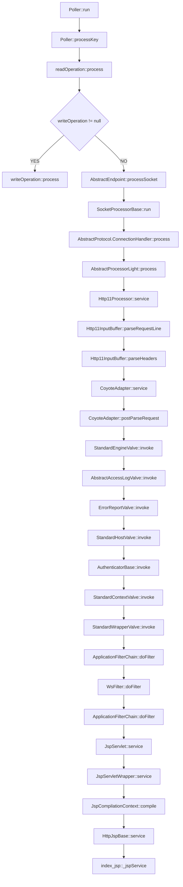
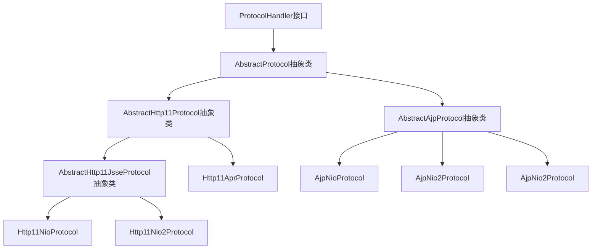
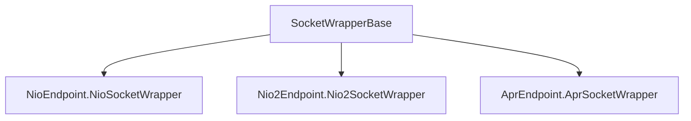
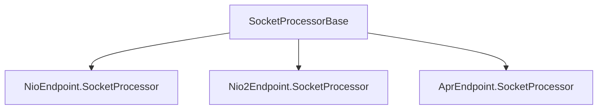
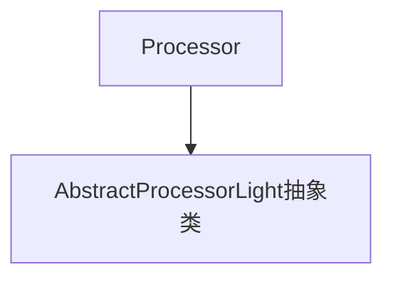
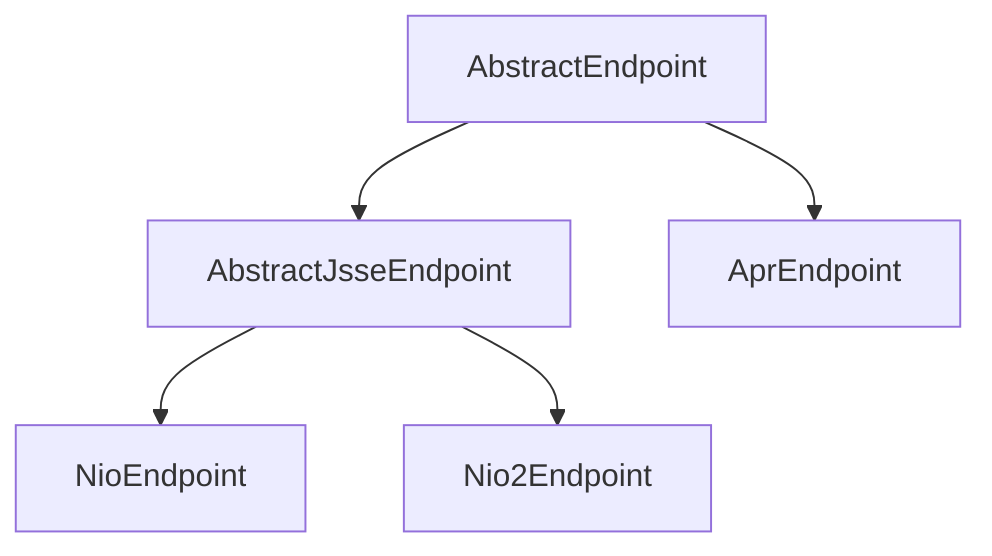
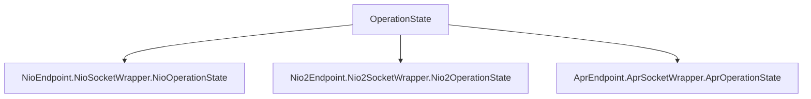
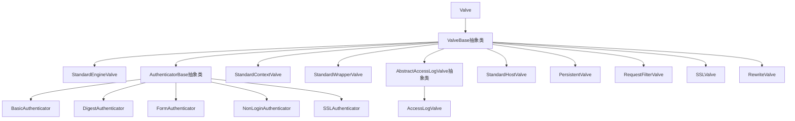

### 搭建调试环境
1. 复制build.properties.default并重命名为build.properties

2. set "JAVA_HOME=D:\tools\java\jdk-22.0.2+9" ; ant -buildfile build.xml ide-intellij

3. Tomcat源码导入IDEA

4. 打开File -> Settings -> Appearance & Behavior -> Path Variables。添加ANT_HOME和TOMCAT_BUILD_LIBS两条变量，值分别设置为ant.home和base.path的实际值

5. 配置启动类，org.apache.catalina.startup.Bootstrap

6. 配置JDK版本、VM options，JDK版本为JDK 22，-Dcatalina.home="D:\work\tomcat\tomcat-fork\tomcat9\tomcat\output\build" -Dfile.encoding=UTF8

7. Project Structure配置Project JDK、Modules JDK为JDK 22

8. 浏览器访问http://127.0.0.1:8080

### 线程

- 线程名称：xxx-Poller，线程类：Poller，线程类型：后台线程，启动入口：
  NioEndpoint::startInternal，作用：处理连接

- 线程名称：xxx-Acceptor，线程类：Acceptor，线程类型：，启动入口：
  NioEndpoint::startInternal，作用：接收连接

### Acceptor state

RUNNING

PAUSED

ENDED

### SocketProcessorBase | SocketProcessor event
STOP

DISCONNECT

ERROR

OPEN_READ

OPEN_WRITE

### Http11Processor
http处理器， 通过AbstractHttp11Protocol创建

### 连接处理流程

ThreadPoolExecutor -> SocketProcessorBase::run ->  NioEndpoint$SocketProcessor::doRun ->
AbstractProtocol$ConnectionHandler::process -> AbstractProcessorLight::process ->
Http11Processor::service -> Http11InputBuffer::parseRequestLine、CoyoteAdapter::service

## Poller流程图



```
说明:
    process方法是通过线程池执行，主要将数据读写至buffer
```

## ProtocolHandler接口及其实现类


## SocketWrapperBase抽象类及其实现类

实现类主要实现doWrite()、doClose()方法


## SocketProcessorBase抽象类及其实现类

实现类主要实现doRun()方法


## Processor接口及其实现类



## AbstractEndpoint抽象类及其实现类


## OperationState抽象类及其实现类


## Valve接口及其实现类



```
说明：ValveBase的实现类还有ErrorReportValve、JDBCAccessLogValve、
ParameterLimitValve、SingleSignOn、CrawlerSessionManagerValve、
StuckThreadDetectionValve、OpenWebBeansSecurityValve、
HealthCheckValve、SpnegoAuthenticator、LoadBalancerDrainingValve、
ReplicationValve、JvmRouteBinderValve、SemaphoreValve、RemoteIpValve
```

## server-registry.xml